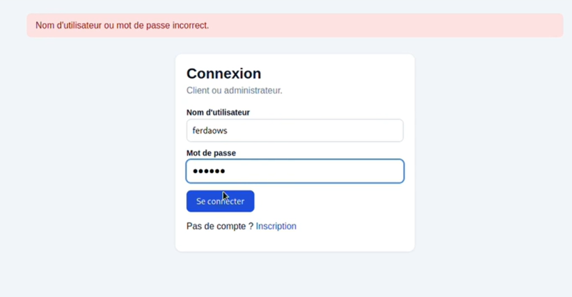
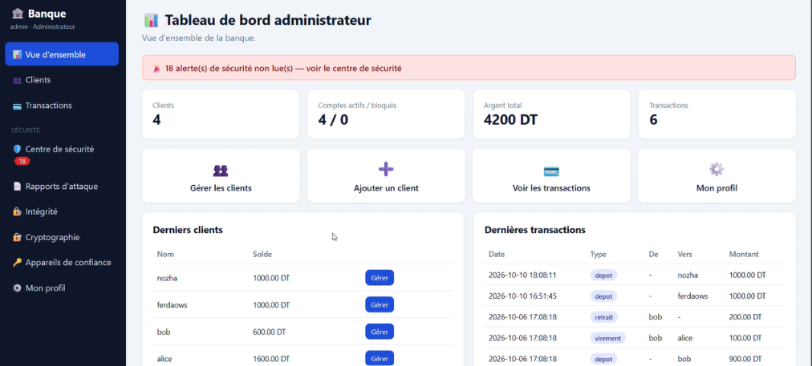
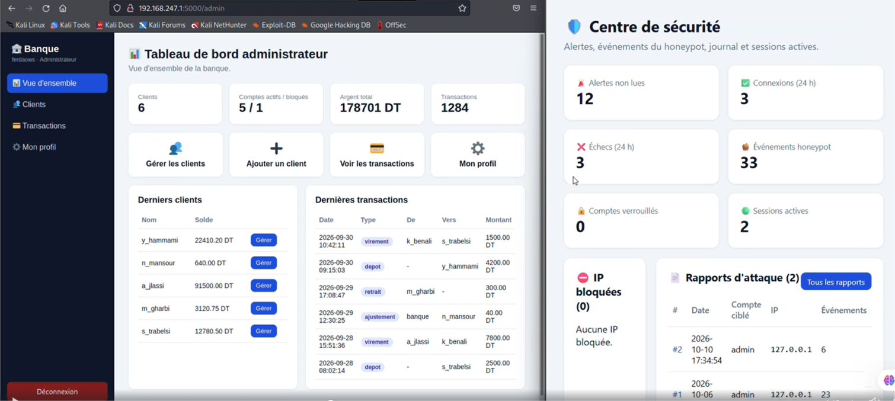
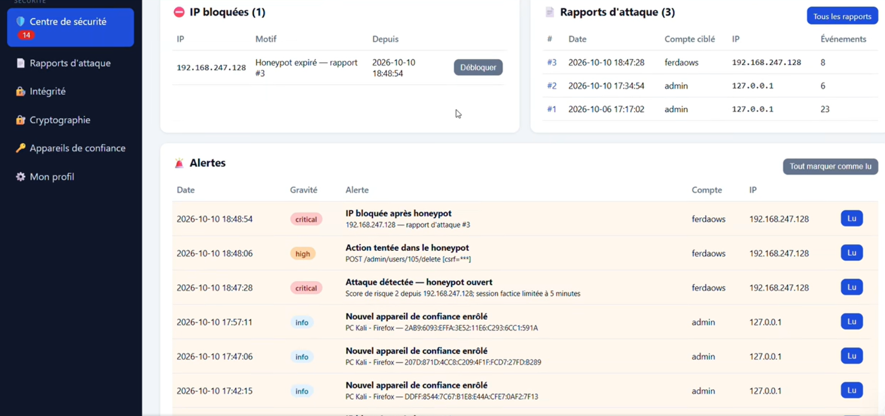

# 🍯 Smart Honeypot & Risk Engine
### Application bancaire web sécurisée qui piège les attaquants

Une banque en ligne développée avec **Python, Flask et SQLite**. Son idée : **la défense active**.
Au lieu de seulement bloquer un attaquant, l'application le **laisse entrer dans un faux tableau de bord**, note tout ce qu'il fait, puis **bloque son IP** et **prévient l'administrateur**.

> Projet réalisé par **<ton nom>** et [Khouloud Bahri](https://www.linkedin.com/in/khouloud-bahri-46173937b/) (cybersécurité : authentification et cryptographie).

---

## 🎯 C'est quoi le but ?

Imagine un voleur qui force la serrure de ta maison. Au lieu de le chasser, on le laisse entrer dans une **fausse maison**. Pendant ce temps, le propriétaire est prévenu et chaque geste du voleur est noté.

| Qui | Ce qu'il voit |
|---|---|
| ✅ Le vrai client / le vrai admin | Le **vrai** tableau de bord |
| 🕵️ L'attaquant suspecté | Un **faux** tableau de bord (honeypot) |
| 👮 L'administrateur | Les alertes et les rapports d'attaque dans son **Centre de sécurité** |

Dans le faux tableau de bord, l'attaquant ne peut **modifier aucune vraie donnée**. Ses actions sont seulement enregistrées.

---

## 🧠 Comment le site décide ? (Risk Engine)

À chaque connexion, le site calcule un **score de risque de 0 à 2**. Il regarde 2 signaux :

| Signal | Points |
|---|---|
| 🔢 **3 mots de passe faux ou plus** en 15 minutes | +1 |
| 🌐 **IP inconnue** ou 🖥️ **navigateur inconnu** pour ce compte | +1 |

> Un « contexte connu » = l'IP **et** le navigateur ont déjà été utilisés par ce compte.

| Score | Situation | Résultat |
|---|---|---|
| **0** | Moins de 3 erreurs **et** IP + navigateur connus | ✅ Connexion normale → vrai dashboard |
| **1** | 3 erreurs ou plus **mais** IP + navigateur connus | ⛔ Message d'erreur normal, **pas de honeypot** |
| **1** | Moins de 3 erreurs **mais** IP ou navigateur inconnu | ⛔ Connexion refusée (même avec le bon mot de passe) : l'admin doit approuver le nouvel appareil |
| **2** | 3 erreurs ou plus **et** IP ou navigateur inconnu | 🍯 **Faux dashboard + alerte critique** |

**Pourquoi ?** Si tu te trompes dans ton navigateur habituel, c'est sûrement toi qui as oublié ton mot de passe : pas de piège. Mais si un **inconnu** (nouvelle IP ou nouveau navigateur) essaie plusieurs fois, c'est suspect : il est piégé.

### Ce qui se passe après l'ouverture du honeypot

```
Score 2 (3 erreurs + contexte inconnu)
                  │
                  ▼
   🍯 Faux dashboard (session limitée à 5 minutes)
        → chaque action de l'attaquant est enregistrée
        → aucune vraie donnée n'est modifiée
        → l'admin reçoit une alerte CRITIQUE
                  │
        (la session expire)
                  ▼
   🚫 IP bloquée → le site ne s'ouvre plus du tout pour cette IP
   📄 Rapport d'attaque créé pour l'admin
```

---

## 📸 Captures d'écran (expliquées)

### 1️⃣ Connexion avec un mauvais mot de passe


Le site affiche seulement « Nom d'utilisateur ou mot de passe incorrect ». Il ne dit **pas** lequel des deux est faux, pour ne pas aider un attaquant.

### 2️⃣ Le vrai tableau de bord de l'administrateur


C'est ce que voit le vrai admin : **4 clients, 4200 DT, 6 transactions**. Il y a une bannière rouge avec les **alertes de sécurité non lues** et un menu **Sécurité** complet : Centre de sécurité, Rapports d'attaque, Intégrité, Cryptographie, Appareils de confiance.

### 3️⃣ À gauche : le FAUX dashboard. À droite : le VRAI Centre de sécurité


- **À gauche** (navigateur Kali de l'attaquant) : un faux dashboard avec des chiffres inventés (**6 clients, 178 701 DT, 1284 transactions**) et un menu réduit. L'attaquant pense être dans la vraie banque.
- **À droite** (compte du vrai admin) : le Centre de sécurité montre en direct les alertes non lues, les échecs de connexion, les **événements honeypot**, les sessions actives et les rapports d'attaque.

### 4️⃣ Alerte, IP bloquée et rapport d'attaque


Après l'expiration du honeypot :
- 🚫 **IP bloquée** : `192.168.247.128`, motif « Honeypot expiré – rapport #3 ». L'admin peut la **débloquer** avec un bouton.
- 📄 **Rapports d'attaque** : le rapport #3 indique la date, le compte ciblé, l'IP et le nombre d'événements (8).
- 🚨 **Alertes** (de la plus grave à la moins grave) :
  - *critique* : « Attaque détectée – honeypot ouvert » (score de risque 2, session factice de 5 minutes)
  - *élevée* : « Action tentée dans le honeypot » (l'attaquant a essayé de **supprimer un utilisateur**, mais rien n'a changé)
  - *critique* : « IP bloquée après honeypot »
  - *info* : « Nouvel appareil de confiance enrôlé »

> 🔒 Une fois l'IP bloquée, l'attaquant **ne trouve plus le site**. Il ne peut plus y entrer.

---

## 🛡️ Fonctions de sécurité

| Fonction | Technologie | En mots simples |
|---|---|---|
| Mots de passe | **scrypt** | Le mot de passe n'est jamais stocké en clair |
| Données sensibles (RIB) | **AES-256-GCM** | Les données sont chiffrées |
| Intégrité | **HMAC-SHA256** | On détecte si une donnée a été modifiée |
| Appareil de l'admin | **ECDSA** (WebCrypto) | Chaque appareil de confiance est vérifié par une signature |
| Protection du site | Sessions côté serveur + **CSRF** | Empêche le vol de session et les faux formulaires |
| Anti brute-force | Verrouillage de compte + blocage d'IP | Stoppe les essais répétés |
| Supervision | Alertes + rapports d'attaque + journal chaîné | L'admin est toujours prévenu |

**Technologies** : Python · Flask · SQLite · OpenSSL · WebCrypto · Pytest · VMware · Kali Linux

---

## 🚀 Installation

```bash
git clone https://github.com/<ton-user>/<nom-repo>.git
cd <nom-repo>
python -m venv .venv
source .venv/bin/activate        # Windows : .venv\Scripts\activate
pip install -r requirements.txt
python app.py                    # puis ouvrir http://127.0.0.1:5000
```

Au premier lancement, la base `bank.db` et les clés (`instance/secrets.json`) sont **créées automatiquement**. Elles ne sont pas dans GitHub.

### Comptes de démonstration (labo uniquement)

| Utilisateur | Mot de passe | Rôle |
|---|---|---|
| `admin` | `Admin@123` | Administrateur |
| `alice` | `Alice@123` | Client |
| `bob` | `Bob@12345` | Client |

⚠️ Ces mots de passe sont volontairement simples, **seulement pour la démo**. Ne jamais les utiliser en vrai.

### HTTPS local (optionnel)
```bash
bash generate_keys.sh && source keys.env && python app.py
```

### Tests
```bash
python -m pytest -v
```

---

## 🎬 Démo (scénario simple)

| Étape | Action | Ce qu'on voit |
|---|---|---|
| 1 | Se connecter avec le bon mot de passe depuis le navigateur habituel | ✅ Vrai dashboard |
| 2 | Se tromper 3 fois depuis ce même navigateur | ⛔ Message d'erreur, **pas** de faux dashboard |
| 3 | Depuis un **nouveau navigateur ou une nouvelle IP**, se tromper 2 fois puis mettre le bon mot de passe | ⛔ Connexion refusée (appareil à approuver), **pas** de faux dashboard |
| 4 | Depuis l'attaquant (Kali, IP inconnue), se tromper **3 fois ou plus** | 🍯 Faux dashboard |
| 5 | Regarder le Centre de sécurité de l'admin | 🚨 Alertes critiques + rapport d'attaque |
| 6 | Attendre la fin de la session honeypot (5 min) | 🚫 IP bloquée, le site ne s'ouvre plus |

📹 Vidéo : `<lien LinkedIn / YouTube>`

---

## 📁 Structure du projet

| Fichier / dossier | Rôle |
|---|---|
| `app.py` | Routes Flask, connexion, dashboards |
| `risk_engine.py` | Score de risque 0 à 2, IP et navigateur de confiance, liste noire |
| `honeypot.py` | Faux dashboard |
| `reports.py` | Expiration du honeypot et rapports d'attaque |
| `security.py` · `server_sessions.py` | CSRF, sessions, alertes, journal HMAC |
| `crypto_utils.py` | AES-GCM, HMAC, ECDSA |
| `db.py` · `config.py` | Base SQLite et secrets |
| `templates/` · `static/` | Pages HTML, CSS, JavaScript |
| `tests/` | Tests Pytest |
| `docs/` | Architecture, tests de sécurité, captures, README technique |
| `tools/` | Petits scripts **de test** (voir ci-dessous) |

### 🔧 Outils de test (`tools/`)

Ces scripts servent seulement à **refaire la démo**. Ils ne font pas partie du site. Les copier à côté de `app.py` avant de les lancer.

| Script | À quoi ça sert |
|---|---|
| `debloquer_ip.py` | Débloque toutes les IP de la liste noire |
| `reparer_connexion.py` | Remet à zéro les échecs, appareils de confiance, IP bloquées et verrouillages |

---

## ⚠️ Avertissement

Projet **éducatif**, testé en laboratoire. Ne pas utiliser tel quel en production. Ne testez pas ce projet sur un système qui ne vous appartient pas.

## 👥 Auteurs

- **<ton nom>** – [LinkedIn](<ton-lien-linkedin>)
- **Khouloud Bahri** – [LinkedIn](https://www.linkedin.com/in/khouloud-bahri-46173937b/)

Vos retours sont les bienvenus ! 💻
