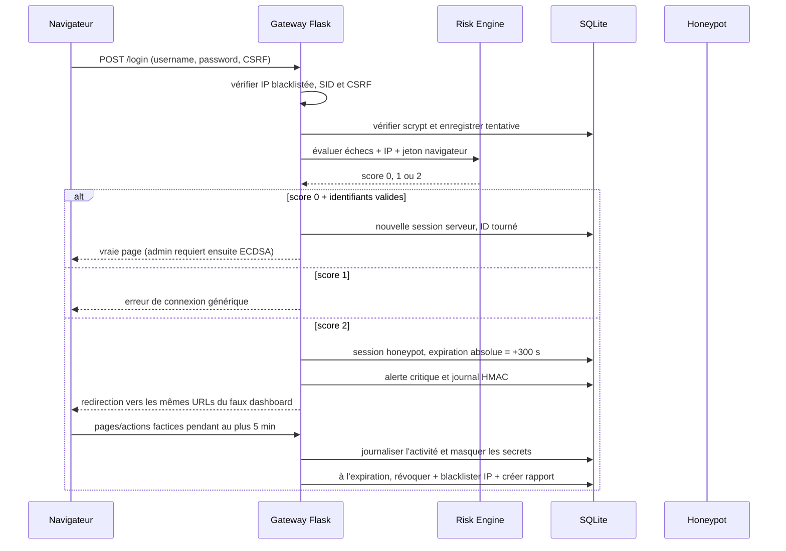

# Architecture finale — Banque sécurisée

## 1. Vue d'ensemble

```text
USER / BROWSER
  │ HTTPS (mTLS optionnel)
  ▼
FLASK SECURITY GATEWAY
  ├── vérifie la blacklist IP
  ├── valide le SID, l'expiration, le User-Agent et le CSRF
  └── transmet vers l'authentification ou intercepte la session honeypot
        │
        ├── LOGIN (username + password, hash scrypt, verrouillage)
        │       ├── journalise chaque tentative (IP, jeton hashé, heure, succès)
        │       └── RISK ENGINE (fenêtre d'échecs : 15 min)
        │              ├── +1 si au moins 3 échecs
        │              ├── +1 si IP OU jeton navigateur est nouveau
        │              └── score plafonné à 2
        │                     ├── 0 → session normale → vrai dashboard
        │                     ├── 1 → erreur de connexion normale, aucun accès
        │                     └── 2 → alerte critique + faux dashboard
        │                               └── 5 min absolues → révocation
        │                                      → IP blacklistée
        │                                      → rapport d'attaque JSON
        │
        ├── ADMIN : après score 0, preuve ECDSA P-256/WebCrypto obligatoire
        │       ├── signature valide → vrai dashboard administrateur
        │       └── absente/fausse/rejouée → honeypot
        │
        └── STORAGE SQLITE
              users · login_attempts · trusted_contexts · sessions
              app_sessions · blacklisted_ips · attack_reports · alerts
              security_logs chaînés HMAC · transactions HMACées
              RIB chiffré AES-256-GCM
```

Le honeypot s'exécute dans `before_request`, avant les vues bancaires. Il ne réutilise aucune mutation réelle : seules les données statiques de `honeypot.py` sont affichées et les actions sont journalisées.

## 2. Politique de score et Security Gateway

Le Risk Engine (`risk_engine.py`) évalue les tentatives par nom d'utilisateur normalisé, dans une fenêtre glissante de 15 minutes :

| Signal | Points |
|---|---:|
| Au moins 3 échecs de connexion pendant la fenêtre | +1 |
| IP absente des contextes reconnus **ou** jeton navigateur absent des contextes reconnus | +1 |
| Score maximal | 2 |

- **Score 0 — normal :** un échec de mot de passe reste refusé; des identifiants valides permettent le login. Le contexte est mémorisé seulement après inscription, connexion de risque faible ou enrôlement d'appareil admin.
- **Score 1 — suspect :** aucun accès n'est accordé; le navigateur reçoit une erreur de connexion ordinaire, sans révéler le signal qui a fait monter le score.
- **Score 2 — attaque :** l'application consigne un événement critique, lève une alerte et crée une session factice de cinq minutes. Si le nom de compte est inconnu ou le mot de passe faux, cette session ne donne toujours accès qu'au faux tableau de bord.

Les comptes historiques sans contexte utilisent un bootstrap unique : la première connexion correcte peut créer la base de confiance. Les comptes nouvellement inscrits ajoutent le contexte au moment de l'inscription. Après changement d'IP ou de navigateur, un administrateur peut approuver le nouveau couple au moyen de la commande locale `flask --app app trust-context USER IP`, après vérification de l'identité sur un canal indépendant. Le jeton est demandé en saisie masquée et seul son hash SHA-256 est stocké.

Un verrouillage classique distinct se déclenche après 5 mauvais mots de passe pendant 15 minutes. Le rate limit IP en mémoire reste un contrôle additionnel.

## 3. Séquence login et honeypot



L'expiration est contrôlée sur chaque requête et peut être balayée par `flask --app app expire-honeypots`. Pour un serveur sans trafic, planifier cette commande côté exploitation afin d'exécuter le blocage/rapport à l'heure voulue.

## 4. Session et contrôles transverses

| Contrôle | Implémentation |
|---|---|
| Stockage | `server_sessions.py` persiste CSRF, pending-login et autres données en SQLite (`app_sessions`) |
| Cookie | HMAC signé, HttpOnly, SameSite=Strict, Secure en HTTPS; ne contient que le SID aléatoire de 256 bits |
| Identifiant en base | SHA-256 du SID; l'identifiant clair n'est pas stocké en base |
| Rotation | Nouvelle ID à la connexion; l'ancienne session authentifiée est révoquée |
| Expiration | 15 minutes d'inactivité, 8 heures absolues pour une session authentifiée; honeypot fixe de 5 minutes |
| Liaison | User-Agent différent : session révoquée, événement critique et alerte |
| CSRF | Jeton aléatoire gardé côté serveur; formulaire et `X-CSRF-Token` vérifiés sur chaque POST |
| Révocation | Logout, changement de mot de passe, compte bloqué, action admin ou expiration |
| Gateway IP | IP blacklistée rejetée avant traitement des pages privées; déblocage admin protégé CSRF |
| En-têtes | CSP sans script inline, `X-Frame-Options: DENY`, `nosniff`, `no-store`, HSTS en HTTPS |

## 5. Authentification d'appareil administrateur

Après le score 0 et la validation du mot de passe, l'administrateur doit prouver la possession d'une clé privée ECDSA P-256. Le navigateur génère une clé privée non-extractable WebCrypto, conservée comme objet `CryptoKey` dans IndexedDB. Le serveur envoie un nonce aléatoire à usage unique, stocké hashé et valide 120 secondes. La signature est vérifiée sur la clé publique SPKI enregistrée en base.

L'enrôlement nécessite mot de passe et code à usage unique valable 30 minutes; le code n'est stocké qu'en SHA-256. Un mot de passe admin sans signature valide mène au honeypot, sans session admin réelle.

## 6. Expiration, liste noire et rapport

À l'échéance absolue du honeypot :

1. La ligne de session est révoquée.
2. L'IP source est inscrite dans `blacklisted_ips` (blocage sans échéance par défaut).
3. L'activité honeypot et les pages/actions uniques sont rassemblées en JSON dans `attack_reports`.
4. Une alerte critique et un événement `HONEYPOT_EXPIRED` sont ajoutés au journal.
5. L'administrateur voit les IP bloquées et rapports dans le Centre de sécurité; la liste de rapports et chaque détail sont accessibles par les pages `/admin/reports`.

Les formulaires honeypot ne conservent pas mots de passe, codes, signatures ni CSRF; les champs sensibles sont masqués avant écriture au journal.

## 7. Données et cryptographie

| Primitive | Usage |
|---|---|
| scrypt + sel | Hash des mots de passe |
| HMAC-SHA256 | Sceau des transactions et chaînage du journal de sécurité |
| AES-256-GCM + AAD=username | Chiffrement du RIB |
| ECDSA P-256 / SHA-256 | Preuve de possession de l'appareil admin |
| SHA-256 | SID, nonce, code d'enrôlement, jeton navigateur en base |
| TLS | HTTPS OpenSSL; mTLS optionnel par CA client locale ou reverse proxy |

## 8. HTTPS / mTLS

La configuration HTTPS standard est activée lorsque le certificat et la clé serveur sont présents. Le mode mTLS est **opt-in** (`MTLS_ENABLED=1`) et requiert une CA client (`CLIENT_CA_FILE`). L'application arrête le démarrage si mTLS est activé sans cette CA. `generate_client_cert.sh` crée une CA et un certificat de démonstration uniquement pour un environnement local. En production, préférer un reverse proxy TLS correctement durci; ne pas utiliser le serveur de développement Flask.

## 9. Tables principales

- `users`: compte, rôle, état, hash scrypt, solde et RIB chiffré.
- `login_attempts`: identité normalisée, IP, hash du jeton, succès, heure et score.
- `trusted_contexts`: IP et hash de jeton par compte.
- `sessions`: session authentifiée, UA, vérification d'appareil, état honeypot et expiration.
- `app_sessions`: données Flask server-side, indexées par hash SID.
- `challenges`, `device_keys`, `enroll_codes`: authentification d'appareil.
- `blacklisted_ips`: IP bloquées après expiration honeypot.
- `attack_reports`: synthèse JSON des incidents.
- `security_logs`, `alerts`: journal HMAC chaîné et centre d'alertes.
- `transactions`: historique scellé par HMAC.

## 10. Limites

- L'IP et le jeton navigateur sont des heuristiques de risque et peuvent changer naturellement; l'approbation d'un nouvel environnement doit être faite avec un second canal.
- La blacklist est persistante sans expiration automatique; son retrait exige une action explicite et auditée d'un administrateur.
- La commande d'expiration doit être planifiée pour un serveur sans trafic si le blocage doit arriver exactement à l'échéance.
- Le contrôle d'intégrité HMAC n'empêche pas un administrateur système ayant les clés de réécrire la base; un ancrage externe est requis pour détecter la suppression de fin de journal.
